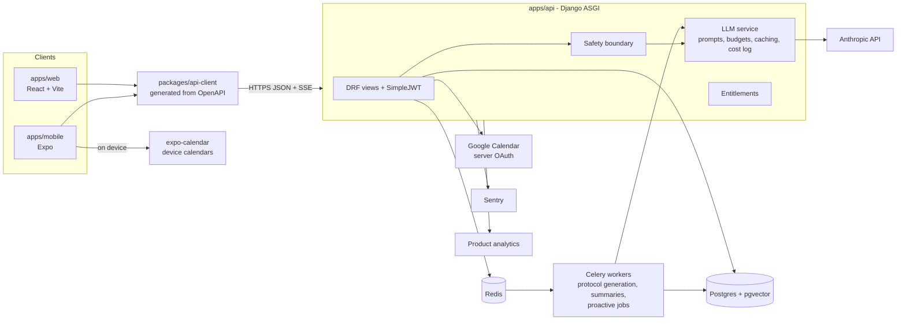
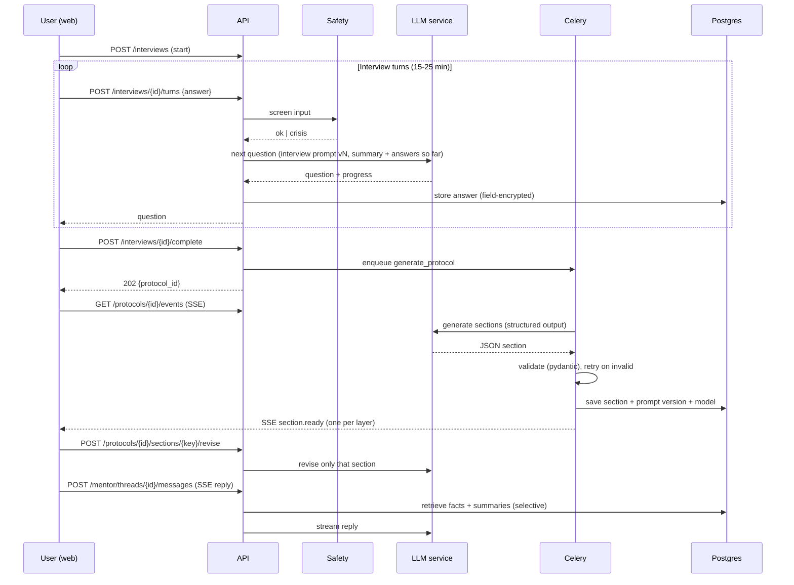
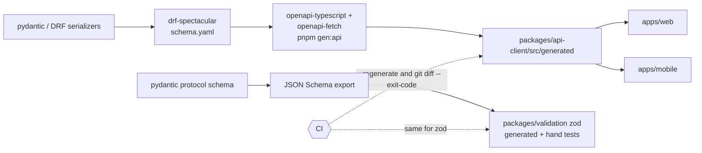
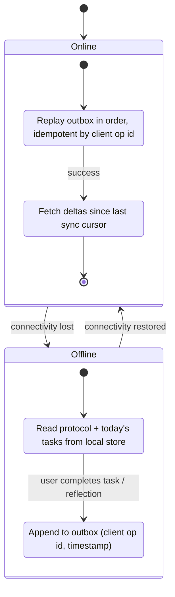

# Architecture

Companion to `PRD.md`. Decisions are recorded in `docs/adr/`. Section numbers like (PRD §8.1) refer to the PRD.

## 1. System overview

Django is the single backend for auth and data. Clients never talk to a database or the model provider directly.

## 2. Onboarding to protocol to mentor

The mentor never receives the full history. Context is the protocol, selected structured facts, and rolling summaries (ADR 0004).

## 3. OpenAPI to client pipeline

CI runs `manage.py spectacular --file schema.yaml`, regenerates the client and zod mirror, and fails on any diff.

## 4. Offline sync (mobile only)

Scope: cache protocol and daily tasks; queue task completions, practice check-ins and reflections. Mentor chat is online only. Conflicts: server wins for protocol; for task state, last-write-wins by client timestamp with server-side monotonic guard (a completed task is not un-completed by an older write). Web has no offline mode (decided).

## 5. LLM service (apps/api/mentor/llm)

- One interface: `generate(task, context) -> Result`, `stream(...)`. Anthropic implementation behind it; tests use a fake.
- Model ID from `ANTHROPIC_MODEL` env. No literals in code.
- Prompts live in versioned files `prompts/<task>/v<N>.md`; every protocol and mentor message stores `prompt_version` and `model`.
- Token budgets per task (input and output caps); requests over budget are trimmed by the context assembler, not by truncating mid-fact.
- Prompt caching for the stable prefix (protocol + memory facts). Cache breakpoint placement is part of the assembler.
- Per-user cost log: `llm_usage(user, task, model, input_tokens, output_tokens, cached_tokens, cost_estimate)`.

## 6. Safety boundary (product is not therapy)

1. Every mentor message and reflection passes the classifier before coaching logic runs.
2. On clinical distress or crisis language: stop coaching, return a fixed supportive redirect with region-appropriate resources, mark thread `paused_safety`.
3. Log an event `safety.boundary_triggered` with category and timestamp only. No content in logs, Sentry or analytics.
4. A human-reviewed resource list is required before Alpha (PRD_GAPS #16).

## 7. Analytics taxonomy (maps to PRD §10)

Tool: PostHog (ADR 0008). Properties never contain free text from users.

| PRD metric | Events | Derivation |
|---|---|---|
| Onboarding completion >70% | `onboarding_started`, `interview_completed`, `protocol_generated` | completed / started |
| Protocol accuracy >80% | `protocol_rated {score 1-5}` | share of 4-5 |
| D7 / D30 retention | `session_active` (daily, server-side) | active on day N after `protocol_generated` |
| Practice streak >12 days | `practice_completed {trait_id}` | consecutive days, computed in DB |
| Sprint completion >50% | `task_completed {layer, sprint_id}` | completed / total sprint tasks |
| NPS >65 | `nps_submitted {score}` | standard NPS |
| North star | `trait_rating_submitted {trait_id, day: 0/14/30}`, `practice_completed` | trait or habit delta within 30 days |
| Supporting | `mentor_message_sent`, `weekly_ritual_completed`, `deep_work_session_completed`, `reflection_completed`, `safety.boundary_triggered` | engagement and safety |

Events are emitted server-side where possible so they reflect truth and respect the consent ledger and AI/analytics opt-outs.

## 8. Privacy and security summary

- TLS everywhere; Postgres at rest encryption from the host; **field-level encryption** (AES-GCM, key from KMS or env-injected key id, versioned) for interview answers, journals, reflections, mentor message bodies (ADR 0005).
- Consent ledger (append-only): purpose, version, timestamp, granted/revoked. AI-training opt-out flag defaults to opted out.
- Data export (JSON + PDF protocol) and hard delete (cascade plus provider-side deletion where applicable).
- GDPR and DPDPA: lawful basis per purpose, grievance contact, region ADR (0006).

## 9. Observability

Sentry for web, mobile, API (PII scrubbing on). Structured JSON logs with request id and user id (UUID), no bodies. `GET /healthz` (liveness) and `GET /readyz` (db, redis). Settings loaded via validated env (pydantic-settings); startup fails on invalid config.

## 10. Entitlements

`Subscription(user, tier, status, period_end)`; `Entitlement` resolved from tier through a static feature map. Views declare required feature keys (`presence`, `legacy`, `calendar`). No payments until pricing is answered (ADR 0007).
