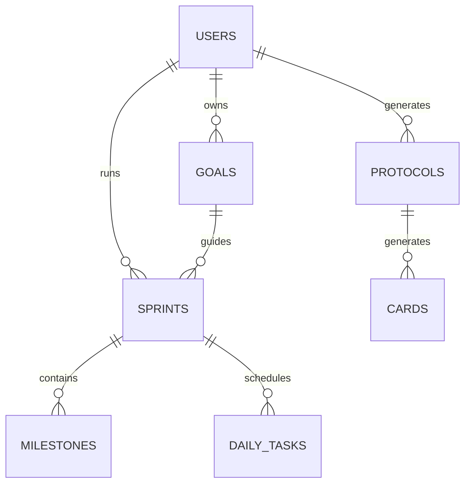

# Alter Ego OS — Data Model & Schema Documentation

## 1. Overview & Architecture
Alter Ego OS persists personal transformation protocols, 90-day sprints, and daily execution loops.
This document defines the schema, table relationships, status state-machines, and encryption policies across PostgreSQL/Supabase and Django models.

---

## 2. Table Specifications & Relationships

### 2.1 `goals`
Stores the high-level seed ambition and time capacity constraints.

| Column | Type | Constraints | Description |
|---|---|---|---|
| `id` | `UUID` | PRIMARY KEY | Unique goal identifier |
| `user_id` | `UUID` | FK -> `auth.users(id)` ON DELETE CASCADE | Target owner |
| `title` | `TEXT` | NOT NULL | Identity statement ("By [date], I want to be someone who...") |
| `situation` | `VARCHAR(32)` | NOT NULL | `know_goal`, `direction`, or `change` |
| `target_date` | `DATE` | NOT NULL | Bounded between 14 and 730 days from creation |
| `weekday_minutes`| `INTEGER` | NOT NULL | Realistic weekday capacity (e.g. 60, 90) |
| `weekend_minutes`| `INTEGER` | NOT NULL | Weekend capacity (e.g. 90, 180) |
| `today_minutes` | `INTEGER` | NOT NULL | Initial kick-off commitment (typically 10-15m) |
| `today_availability`| `VARCHAR(64)` | NULL | Chosen slot ("Right now", "Lunch break", etc.) |
| `created_at` | `TIMESTAMPTZ`| DEFAULT `NOW()` | Creation timestamp |
| `updated_at` | `TIMESTAMPTZ`| DEFAULT `NOW()` | Last modified timestamp |

### 2.2 `sprints`
Represents active 90-day execution horizons.

| Column | Type | Constraints | Description |
|---|---|---|---|
| `id` | `UUID` | PRIMARY KEY | Unique sprint identifier |
| `user_id` | `UUID` | FK -> `auth.users(id)` | Target owner |
| `goal_id` | `UUID` | FK -> `goals(id)` | Associated goal |
| `start_date` | `DATE` | NOT NULL | Sprint start date |
| `target_date` | `DATE` | NOT NULL | Target end date |
| `needs_review` | `BOOLEAN` | DEFAULT `false` | True when 14-day calibration cycle completes |
| `created_at` | `TIMESTAMPTZ`| DEFAULT `NOW()` | Timestamp |

### 2.3 `milestones`
Strategic waypoints along the sprint timeline.

| Column | Type | Constraints | Description |
|---|---|---|---|
| `id` | `UUID` | PRIMARY KEY | Unique milestone identifier |
| `sprint_id` | `UUID` | FK -> `sprints(id)` | Parent sprint |
| `title` | `TEXT` | NOT NULL | Waypoint title |
| `target_date` | `DATE` | NOT NULL | Target completion date |
| `status` | `VARCHAR(32)` | `pending`, `in_progress`, `completed` | Milestone status |
| `horizon` | `VARCHAR(32)` | `2_weeks`, `1_month`, `90_days` | Relative horizon tag |

### 2.4 `daily_tasks` (with Fallback Contingency)
Daily execution tasks incorporating if-then fallbacks.

| Column | Type | Constraints | Description |
|---|---|---|---|
| `id` | `UUID` | PRIMARY KEY | Unique task identifier |
| `sprint_id` | `UUID` | FK -> `sprints(id)` | Associated sprint |
| `milestone_id`| `UUID` | FK -> `milestones(id)` NULL | Associated milestone |
| `title` | `TEXT` | NOT NULL | Core task description |
| `layer` | `VARCHAR(32)` | `identity`, `character`, `knowledge`, `daily-os`, `mission`, `presence`, `legacy` | Protocol layer |
| `week_number` | `INTEGER` | NOT NULL | Active planning week (1 or 2) |
| `estimated_minutes` | `INTEGER` | DEFAULT 30 | Standard full duration |
| `fallback_plan`| `TEXT` | NOT NULL | If-then emergency contingency |
| `did_15_min_version`| `BOOLEAN` | DEFAULT `false` | Fallback toggle state |
| `status` | `VARCHAR(32)` | `pending`, `completed` | Execution state |

### 2.5 `protocol_cards`
Interactive modular calibration cards.

| Column | Type | Constraints | Description |
|---|---|---|---|
| `id` | `UUID` | PRIMARY KEY | Unique card identifier |
| `slug` | `VARCHAR(64)` | UNIQUE NOT NULL | e.g. `goal`, `reality`, `calibration`, `habits` |
| `title` | `TEXT` | NOT NULL | Card title |
| `state` | `VARCHAR(32)` | `locked`, `needs_input`, `calibrating`, `active`, `needs_review` | Card lifecycle state |
| `unlock_reason`| `TEXT` | NULL | e.g. "Opens on day 3", "After your plan" |
| `question_count`| `INTEGER` | DEFAULT 0 | Total question steps |
| `estimated_minutes`| `INTEGER` | DEFAULT 5 | Estimated completion time |
| `completed` | `BOOLEAN` | DEFAULT `false` | True when all steps answered |

---

## 3. Data Integrity & Security Rules

1. **DEBUG-Only Date Manipulation (`manage.py goals_shift_days`)**:
   - Date modifications backward in time are strictly restricted to `settings.DEBUG = True`.
   - Never permitted in production environments.
2. **Encrypted Fields Protection**:
   - User secrets, tokens, and OAuth keys are encrypted at rest using AES-GCM.
   - Django Admin enforces `ReadOnlyEncryptedFieldsAdmin` on all sensitive fields to prevent plain text exposure or accidental overwriting.
3. **Transactional Atomicity**:
   - All multi-table updates (seed generation, tradeoff selection, date shifting) execute inside `transaction.atomic()`.

