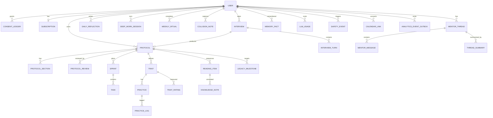

# Data model

IDs are UUIDs. `enc` marks field-level encrypted columns (ADR 0005). Timestamps are UTC `timestamptz`. Django app in brackets.

## Entities by Django app

| App | Table | Key fields |
|---|---|---|
| accounts | `user` | email, password (Argon2), display_name, timezone, locale, `ai_training_opt_out` (default true), `deleted_at` |
| accounts | `consent_ledger` | user, purpose (`ai_processing`, `analytics`, `marketing`, `terms`), version, granted bool, at, ip_hash. Append-only |
| billing | `subscription` | user, tier (`core`,`full`), status, source (`grant`,`web`,`apple`,`google_play`), current_period_end |
| protocol | `interview` | user, status, prompt_version, started_at, completed_at |
| protocol | `interview_turn` | interview, idx, question, answer `enc`, layer_input |
| protocol | `protocol` | user, interview, version, schema_version, status (`generating`,`ready`,`failed`), prompt_version, model, accuracy_rating, `json` (validated, full) |
| protocol | `protocol_section` | protocol, key (`identity`,`character`,`knowledge`,`mission`,`daily_os`,`presence`,`legacy`,`checklist`,`sprint`), content jsonb, revision, generated_at |
| protocol | `protocol_review` | protocol, reviewer, accuracy 1-5, flags[], notes. Internal queue for first 500 |
| daily_os | `sprint` | protocol, starts_on, ends_on, goals jsonb |
| daily_os | `task` | sprint, `layer`, title, detail, block, minutes, due_date, recurrence, source (`checklist30`,`sprint90`,`mentor`), done_at |
| daily_os | `daily_reflection` | user, date, answers `enc` (3 questions), rating |
| daily_os | `deep_work_session` | user, task?, started_at, ended_at, planned_min |
| daily_os | `weekly_ritual` | user, week_start, output_summary `enc`, completed_at |
| character | `trait` | protocol, name, statement, rationale, level |
| character | `practice` | trait, cadence (`daily`,`weekly`), description |
| character | `practice_log` | practice, date, done. Unique(practice, date) |
| character | `trait_rating` | trait, day_offset (0, 14, 30), score 1-5, note `enc`. North-star data |
| knowledge | `reading_item` | protocol, title, author, sequence, rationale, status, source_id (curated set) |
| knowledge | `knowledge_note` | item, destruction_test `enc`, notes `enc` |
| knowledge | `collision_note` | user, text `enc`, domains[] |
| knowledge | `curated_source` | title, url, summary, embedding. Retrieval corpus |
| presence | `presence_practice`, `wardrobe_audit` | Beta |
| legacy | `legacy_milestone` | protocol, horizon (`2y`,`5y`,`life`), statement, criteria jsonb, status |
| legacy | `quarterly_review`, `monthly_board` | Beta; board has four quadrants jsonb |
| mentor | `mentor_thread` | user, kind (`chat`,`weekly`,`board`,`sprint`), status (`open`,`paused_safety`) |
| mentor | `mentor_message` | thread, role, body `enc`, prompt_version, model, tokens |
| mentor | `thread_summary` | thread, text `enc`, covers_to_message |
| mentor | `memory_fact` | user, kind, text `enc`, embedding vector, supersedes, confidence, deleted_at |
| mentor | `proactive_job` | user, kind, scheduled_for, status, idempotency_key |
| mentor | `llm_usage` | user, task, model, input/output/cached tokens, cost, at |
| mentor | `safety_event` | user, thread, category, at. No content |
| analytics | `event_outbox` | name, user, props jsonb (no free text), sent_at |
| accounts | `calendar_link` | user, provider (`google`), token `enc`, scope, status |

## Notes
- `task.layer` enables "4 missed are all Knowledge" (PRD §7.2) as a plain GROUP BY.
- `protocol.json` stores the whole validated document; `protocol_section` rows enable revising one section without regeneration. Sections are the source of truth after first revision; `protocol.json` is regenerated from sections on read.
- Streaks are derived from `practice_log`, not stored.
- Hard delete cascades from `user`; `llm_usage` and `safety_event` are anonymised (user nulled) rather than retained with identity.

## Phase 2 as built
- `protocol_section.content` and `instruction` are **field-encrypted** (not plain jsonb as first drawn): section content embeds the user's own words, fears and constraints. Reviewers decrypt through the admin; every view is logged by protocol id only.
- `interview_turn` also stores `acknowledgement`, `progress`, `suggestions`, `multi_select`, `placeholder` so an interview can resume exactly.
- `protocol_event` is an append-only progress log (type + small data) that the SSE endpoint replays.
- `protocol.review_required` is true for the first 500 protocols; `protocol_review` rows are written from Django admin.
- `llm_usage` records task, model, prompt version and token counts only (no content).
- Revisions are append-only rows; the highest `revision` per `(protocol, key)` is current.
- `checklist_30` is stored as a section wrapper `{tasks: [...]}`; the assembled document exposes the bare list.
